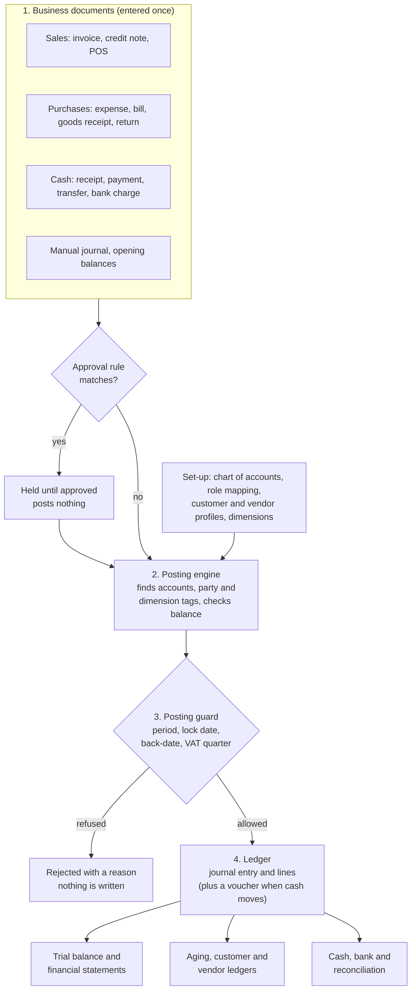
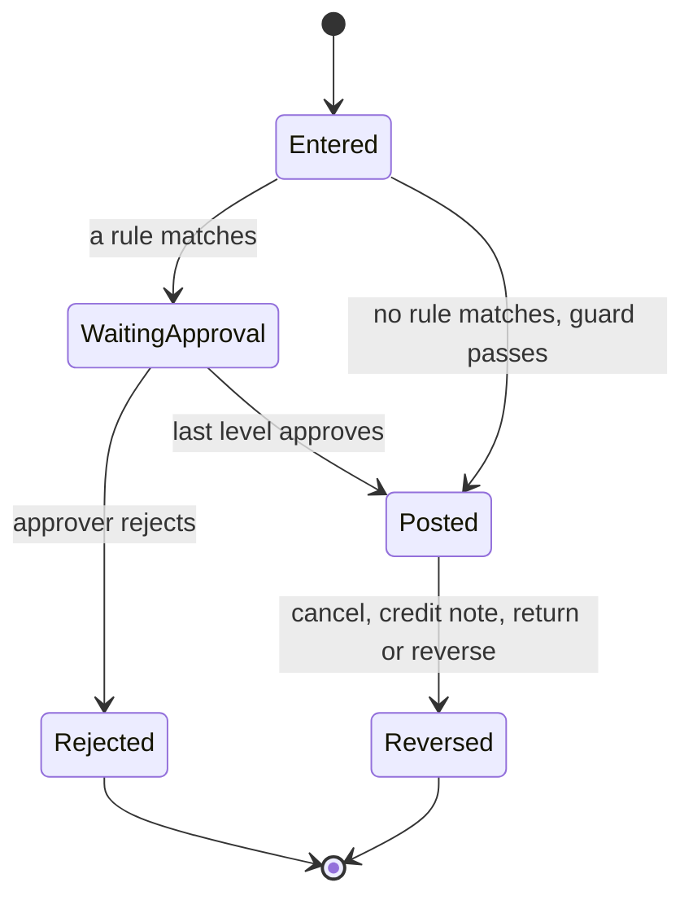
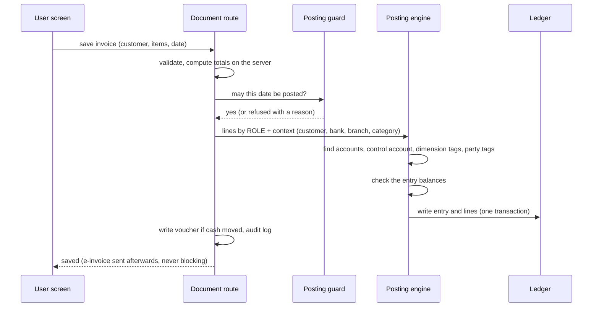
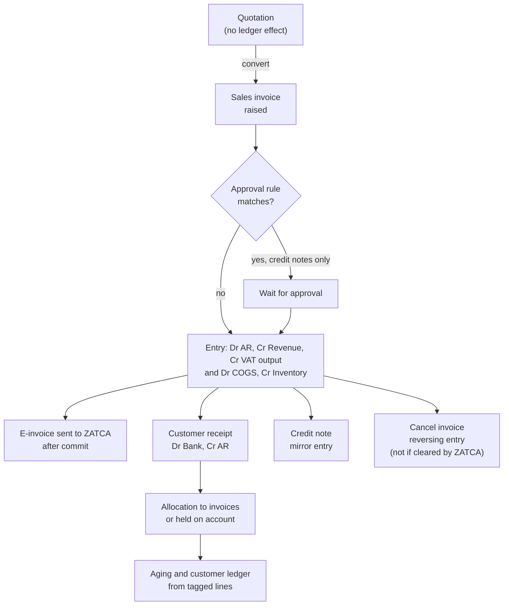
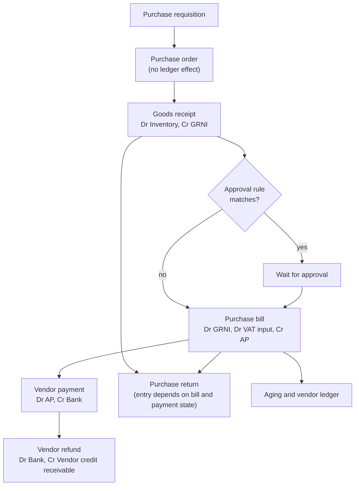
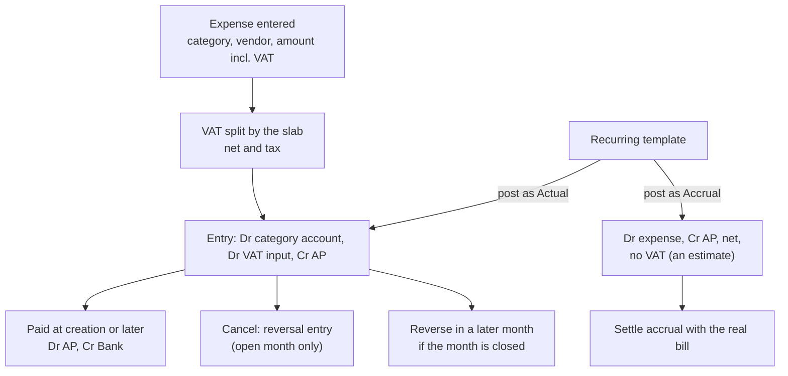
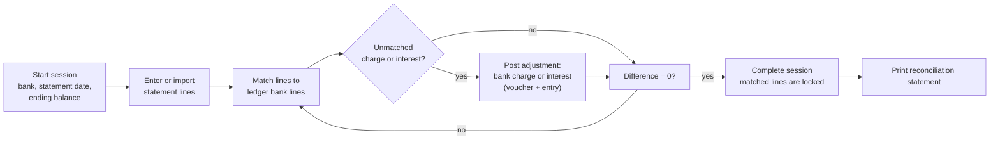
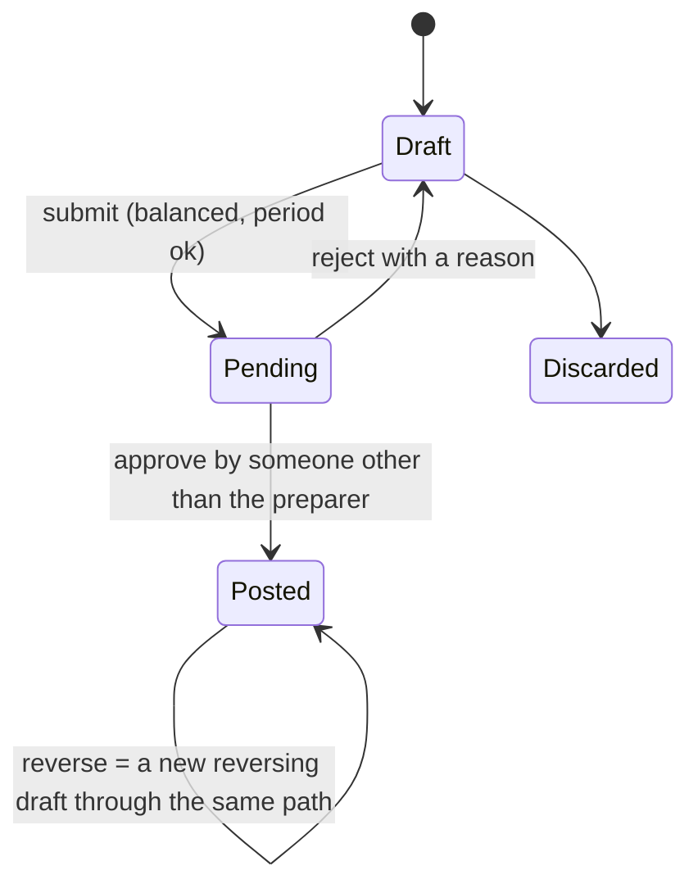
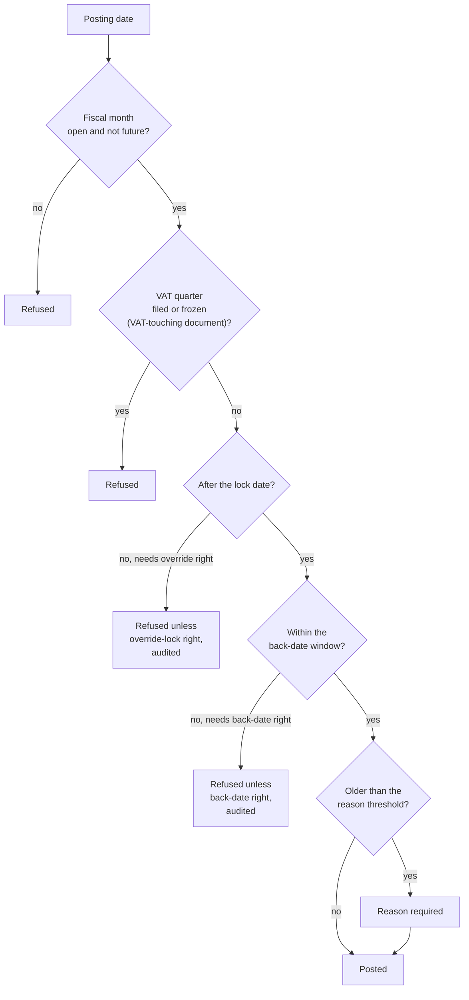

# Warraq ERP finance core: how the General Ledger, Receivables, Payables and Expenses work

**Review pack for a finance professional.** Version of 19 October 2026. Describes Warraq 2.0 (the Demo). Live (1.0) does not have the ledger yet.

## 0. How to use this pack

**Purpose.** This document explains, in accounting terms, how the system is structured, how each business document turns into ledger entries, how periods and controls work, and what is not yet built. It is written so that an accountant can judge whether the design is sound **before** further development. Nothing in it is built on an assumption you have not seen.

**What we ask of you.**

1. Read sections 1 to 5 (structure and mechanism), then the process chapters 6 to 10.
2. At the end of each section there is a short list of **review questions**. Mark each one *Accept*, *Change* or *Question*, with a comment. Section 15 collects all of them in one table you can return.
3. Section 13 lists what is **not** built and section 14 the changes already proposed. Please say which matter most for the businesses you advise (retail, trading, manufacturing, real estate, services).

**Conventions.** *Dr* is debit, *Cr* is credit. Amounts are in Saudi riyals. Account codes are from the standard starter chart; every company can change them. "As built" means the code does this today; "proposed" means it is a design for discussion and does nothing yet.

**What this pack covers.** The general ledger (chart of accounts, dimensions, posting, periods, journals, reports), receivables (customers, invoices, credit notes, receipts), payables (vendors, purchase bills, goods receipts, returns, payments), expenses (including recurring and accrued), cash and bank (including reconciliation), approvals, and the VAT as it is handled today. It does not cover point-of-sale hardware, e-invoicing mechanics (ZATCA) or payroll.

## 1. The system on one page

### 1.1 The idea

Every business event is entered **once**, as a *document* (an invoice, a bill, an expense, a receipt, a journal). The document is stored for operational use (lists, printing, e-invoicing) **and** posted to a single double-entry ledger. All financial reports are queries over that ledger. There is one posting mechanism, and it applies the same controls to every document.

### 1.2 Principles (what the design guarantees)

1. **One ledger, one engine.** Every report is a query over posted lines; there is no second calculation.
2. **A document names *who and what*, never accounts.** The engine finds the accounts (section 3 and 5).
3. **Every entry balances** (debits equal credits) and is refused otherwise.
4. **Posted entries are never edited or deleted.** A correction is a reversing entry.
5. **Control accounts** (receivables, payables, inventory, banks, VAT) can be posted only by their own documents, so their balance is always the sum of their subledger.
6. **One guard for dates.** Every posting passes the same period and control check.
7. **Dimensions** (branch, department, anything the company defines) tag every line for analysis and never change an account balance.
8. **Every cash movement is a voucher** and also an entry, so cash reports and the ledger agree.
9. **Approval holds, never half-posts.** A document waiting for approval has posted nothing.
10. **Full audit trail.** Who did what and when is recorded; nothing is physically deleted.

### 1.3 The lifecycle of a document

A document that reaches the ledger is *Posted*. The only way back is a **reversing entry** dated within the rules of the period (section 9).

**Review questions (section 1).** 1.1 Are the ten principles the ones you would require of a ledger? 1.2 Is anything missing that an auditor would expect?

## 2. Vocabulary used in this pack

| Term | Meaning |
|---|---|
| Document | A business record (invoice, bill, expense, receipt, journal). Has a **document date** and a **posting date** |
| Voucher | The cash side of a document: Receipt, Payment, Reversal, Transfer. Every cash movement has one |
| Entry and line | A balanced set of debit and credit lines in the ledger. A document can raise more than one entry (for example the invoice and its cost of sales) |
| Role | A purpose such as *Accounts receivable* or *Sales revenue*. Documents post to roles; the company maps each role to one account |
| Control account | An account that only its own subledger may post to (receivables, payables, inventory, banks, VAT, goods received not invoiced) |
| Tag | Extra facts on a line: customer, vendor, dimensions |
| Dimension | An analytical type (Branch, Department, or any the company adds) with values; a line can carry one value of each type |
| Allocation | The application of a receipt or payment to specific documents; the remainder is "on account" |
| Posting guard | The check every dated posting passes (open month, lock date, back-date window, VAT quarter, permissions) |
| GRNI | Goods received not invoiced: the clearing account between a goods receipt and its bill |

## 3. The chart of accounts

### 3.1 Structure

* **Owned by each company.** Every company has its own chart; it is created automatically from a standard starter chart and may be changed.
* **Account record:** code (unique in the company), English name, Arabic name, **type** (Asset, Liability, Equity, Revenue, Expense), parent, heading flag, active flag.
* **Hierarchy:** up to four levels; a parent must be a heading of the same type; no loops. **Headings** total their children and take no postings.
* **Account types** are exactly the five above. Sub-classification (current, non-current, cash-flow class) is *not* held on the account today (see section 13).
* **Rules:** an account's type cannot change once it has postings; an account cannot be deactivated while it has a balance, a role, a bank, or active children.
* **Import and export** to Excel, with a preview before anything is saved.

### 3.2 Posting roles

Documents do not choose accounts. They post to one of **16 roles**; the company's mapping decides the account. Re-pointing a role changes **future** postings only; history stays where it was posted.

| Role | Meaning | Starter account | Posted by |
|---|---|---|---|
| BANK | Cash and bank (each bank or cash account gets its own account automatically) | 1010 and 1020 onwards | receipts, payments, transfers, bank charges |
| AR | Accounts receivable (control account, customer tag) | 1100 | invoices, credit notes, receipts |
| INVENTORY | Stock at cost (control account) | 1200 | goods receipts, cost of sales, returns, stock adjustments |
| VAT_INPUT | Recoverable input VAT (control) | 1300 | expenses, bills, returns |
| VENDOR_CREDIT_RECEIVABLE | Amounts owed back by vendors after returns of paid goods (control) | 1350 | purchase returns, vendor refunds |
| FIXED_ASSETS | Fixed assets at cost | 1400 | expenses classified as assets |
| AP | Accounts payable (control account, vendor tag) | 2010 | expenses, bills, payments |
| GR_IR_CLEARING | Goods received not invoiced (control) | 2050 | goods receipts, bills, returns |
| VAT_OUTPUT | VAT collected (control) | 2100 | invoices, credit notes |
| VAT_PAYABLE_TO_AUTHORITY | Net VAT due to the authority (control) | 2150 | (reserved for the VAT settlement) |
| PAID_IN_CAPITAL | Owner capital | 3010 | investor contributions |
| RETAINED_EARNINGS | Accumulated profit | 3100 | (reserved for year-end close) |
| SALES_REVENUE | Revenue net of discounts | 4010 | invoices |
| COGS | Cost of goods sold | 5010 | invoices with stock items, stock adjustments |
| DIRECT_OPEX | Default operating expense | 6010 | expenses without a mapped category |
| ROUNDING_ADJUSTMENT | Cash rounding | 7900 | (reserved) |

**Expense categories** (the fixed list on the expense screen) are mapped to accounts: Admin Expenses 6010, Staff Salaries 6100, Office Purchases 6200, Repair and Maintenance 6300, Government Expenses 6400, Other Expenses 6500. The mapping can be changed per company.

### 3.3 Control accounts

A control account has a **subledger type** (customer, vendor, inventory, bank, tax or clearing). Only documents of that subledger can post to it; **manual journals and opening sheets refuse it.** Several control accounts of one type are allowed (for example trade receivables and staff receivables), and a customer or vendor can name its own control account on its record. Each receivable or payable line carries a customer or vendor **tag**, which is what makes aging and statements exact: a consistency check proves that the control account equals the sum of its parties.

### 3.4 The starter chart

| Code | Account | Type | Role |
|---|---|---|---|
| 1000 | Assets | Asset (heading) | |
| 1010 | Cash and Bank (unallocated) | Asset | BANK |
| 1100 | Accounts Receivable | Asset | AR |
| 1200 | Inventory | Asset | INVENTORY |
| 1300 | VAT Input (Recoverable) | Asset | VAT_INPUT |
| 1350 | Vendor Credit Receivable | Asset | VENDOR_CREDIT_RECEIVABLE |
| 1400 | Fixed Assets | Asset | FIXED_ASSETS |
| 1450 | Accumulated Depreciation | Asset | |
| 2000 | Liabilities | Liability (heading) | |
| 2010 | Accounts Payable | Liability | AP |
| 2050 | Goods Received Not Invoiced | Liability | GR_IR_CLEARING |
| 2100 | VAT Output (Payable) | Liability | VAT_OUTPUT |
| 2150 | VAT Payable to Authority | Liability | VAT_PAYABLE_TO_AUTHORITY |
| 2200 | Accrued Expenses | Liability | |
| 2300 | Zakat Payable | Liability | |
| 3000 | Equity | Equity (heading) | |
| 3010 | Owner Capital | Equity | PAID_IN_CAPITAL |
| 3100 | Retained Earnings | Equity | RETAINED_EARNINGS |
| 3200 | Owner Current Account | Equity | |
| 4000 | Revenue | Revenue (heading) | |
| 4010 | Sales Revenue | Revenue | SALES_REVENUE |
| 4100 | Other Income | Revenue | |
| 5000 | Cost of Sales | Expense (heading) | |
| 5010 | Cost of Goods Sold | Expense | COGS |
| 6000 | Operating Expenses | Expense (heading) | |
| 6010 to 6700 | Administrative, Salaries, Office, Repairs, Government fees, Other, Depreciation | Expense | DIRECT_OPEX (6010) |
| 7000 | Other Items | Expense (heading) | |
| 7900 | Rounding Adjustment | Expense | ROUNDING_ADJUSTMENT |

Accumulated depreciation, depreciation expense and zakat payable exist as accounts for manual use; there is no fixed-asset or zakat module.

### 3.5 Example: control accounts protect the subledger

An accountant tries to post a manual journal *Dr Accounts Receivable 500 / Cr Sales 500*. The system refuses: *"Accounts Receivable is a control account; use a receivable document."* This is deliberate: a manual entry to a control account would make the receivable total differ from the sum of customer balances.

**Review questions (section 3).** 3.1 Is a five-type chart with a heading hierarchy enough, or do you require sub-classification on the account (current and non-current, cash-flow class, statutory line)? 3.2 Is the role mechanism an acceptable way to let documents find accounts? 3.3 Are the 16 roles the right set? 3.4 Would you allow controlled manual adjustments to control accounts? 3.5 Is the starter chart acceptable as a Saudi starting point or should it follow a specific statutory format?

## 4. Dimensions

### 4.1 How they work

A **dimension type** is an analytical view of the business: *Branch* and *Department* exist from the start; a company can add as many as it needs (product line, project, region, channel). Each type has **values**, which can form a hierarchy. A ledger line carries at most one value of each type; the set of values on a line is stored as one deduplicated **combination**, so filtering is one indexed lookup however many types exist. There is no limit on the number of types.

Dimensions are **analytical**: they never change an account's balance. A balance sheet filtered by a dimension is shown as partial.

### 4.2 Rules per account

Each account can say, for each dimension type, **Required**, **Optional** or **Not allowed**, with an optional default. A manual journal line that breaks a Required rule is refused. Documents (invoices, bills, expenses) apply the defaults but do not yet enforce Required, because their forms do not yet collect dimensions (planned).

### 4.3 Where a line's tags come from

The engine fills tags in this order, the first source that has a value wins: the line itself, the document, the customer's or vendor's default, the bank's default, the account's default. Tags the account does not allow are dropped.

### 4.4 Example

A company has Branch (Riyadh, Jeddah) and Department (Sales, Admin). Account 6010 Administrative Expenses has the rule *Department: Required, default Admin*. A manual journal *Dr 6010 1,000 / Cr 2200 Accrued Expenses 1,000* with no department is refused until a department is chosen; with *Branch: Jeddah* and *Department: Admin* it posts, and the trial balance can then be run for Jeddah only, or for Admin across all branches.

### 4.5 Reporting by dimension

Every report row and column can filter by any dimension (including all descendants of a hierarchical value). A report that **breaks down** by every value automatically is proposed, not built.

**Review questions (section 4).** 4.1 Is "analytical tags that never change balances" the right model for your clients, or do you need profit-centre balance sheets (balanced per unit)? 4.2 Is Required, Optional or Not allowed per account sufficient? 4.3 Do you need rules by document type or amount?

## 5. The posting engine

### 5.1 What happens when a document is saved

All of this happens in **one database transaction**: either the document, its entries and its voucher all exist, or none do.

### 5.2 How the engine finds an account

For each line a document says *what role* and *who/what it concerns* (customer, vendor, bank, expense category, branch). The engine resolves in this order: the party's own control account (for receivables and payables), the bank's own account (for cash lines), the expense category's mapped account, then the company's mapping for the role. Dimension tags are merged as in section 4.3. This means that *selecting a customer on an invoice is enough*: no one picks an account.

### 5.3 Reversals

A cancellation, credit note, return or receipt cancellation never edits the original. The engine finds every unreversed entry of the document and writes mirror entries on the reversal date (which must itself pass the guard). A bank line already **reconciled** cannot be reversed until the reconciliation is reopened.

### 5.4 Who and when: two dates

Every document has a **document date** (the date on the paper, used for registers and aging) and a **posting date** (the date the ledger and the period controls use). They are equal unless a back-dating rule applies. Financial statements and period locks use the posting date.

**Review questions (section 5).** 5.1 Is resolving accounts from role plus party, bank and category the right level of automation, or do you need rules by item class and transaction type? 5.2 Is "reverse, never edit" acceptable for all corrections?

## 6. What each document posts

All entries also carry the dimension and party tags described above. Dr is debit and Cr credit.

| Source document | Voucher | Entry | Date used by the guard |
|---|---|---|---|
| **Sales invoice** | none; **Receipt** if paid at creation | Dr Accounts receivable (customer) for the total; Cr Sales revenue net of discount; Cr VAT output. For stock items a second entry: Dr Cost of goods sold / Cr Inventory at average cost | posting date |
| Payment recorded with the invoice | Receipt | Dr Bank / Cr Accounts receivable | payment date |
| **Credit note** | Reversal if money is refunded | Mirror of the invoice lines it reverses (and, for stock items, the cost of goods sold is adjusted by the change in stock valuation); one credit note per invoice; reverses the receipt of a paid invoice | issue date |
| **POS sale or return** | Receipt or Reversal | As invoice or credit note | sale date |
| **Customer receipt** (Receive Payment) | Receipt | Dr Bank / Cr Accounts receivable (customer tag), allocated to chosen invoices; the rest stays on account | document date |
| **Expense** (actual) | none; **Payment** if paid at creation | Dr the category's expense account (net); Dr VAT input; Cr Accounts payable (vendor). Fixed-asset class: Dr Fixed assets | posting date |
| Expense payment | Payment | Dr Accounts payable / Cr Bank | payment date |
| **Accrual** (estimate) | none | Dr operating expense / Cr Accounts payable at net, no VAT | posting date |
| **Goods receipt** | none | Dr Inventory / Cr Goods received not invoiced, at cost, no VAT | receipt date |
| **Purchase bill** | none; **Payment** if paid | Dr Goods received not invoiced; Dr VAT input; Cr Accounts payable (vendor) | posting date |
| **Vendor payment** (Pay Vendor) | Payment | Dr Accounts payable (vendor tag) / Cr Bank, allocated to bills and expenses; the rest on account | document date |
| **Purchase return** | Reversal or Receipt as applicable | Unbilled: Dr GRNI / Cr Inventory. Billed, unpaid: Dr Accounts payable / Cr Inventory, Cr VAT input. Billed, paid: Dr Vendor credit receivable / Cr Inventory, Cr VAT input | return date |
| **Vendor refund** | Receipt | Dr Bank / Cr Vendor credit receivable | refund date |
| **Stock adjustment or stock take** | none | The change in stock valuation: shortage Dr Cost of goods sold / Cr Inventory; surplus the opposite | date |
| **Warehouse transfer** | none | No ledger entry: stock moves between warehouses; there is one inventory account (in-transit is not tracked) | |
| **Inter-bank transfer** | Transfer out and in | Dr Bank (to) / Cr Bank (from) | transfer date |
| **Investor contribution** | Receipt | Dr Bank / Cr Paid-in capital | date |
| **Bank charge** (from reconciliation) | Payment | Dr expense account chosen / Cr Bank | statement line date |
| **Bank interest** (from reconciliation) | Receipt | Dr Bank / Cr income account chosen | statement line date |
| **Manual journal** | none | As entered; control and bank accounts refused | posting date, checked at submit and at approval |
| **Opening balances** | none | As entered, with an optional equity balancing line | opening date |
| **Cancel a receipt or payment** | Reversal | Mirror entry; allocations undone | cancel date |

Two consequences worth stating:

* **Cash basis versus accrual:** an expense or bill is posted when it is *raised*, and payment is a separate entry; the ledger is on the accrual basis.
* **Voucher and entry are separate things:** the voucher is the cash record shown on cash reports and printed vouchers; the entry is the ledger record. Both are created in the same transaction.

**Review questions (section 6).** 6.1 Check each row: is the entry correct for the event? 6.2 Is cost of sales at the time of invoice (average cost) acceptable? 6.3 Should a warehouse transfer post to an in-transit account? 6.4 Should discounts be recorded in a contra-revenue account instead of netting into revenue? 6.5 Should stock adjustments go to cost of sales or to a separate shrinkage account?

## 7. Process flows end to end

### 7.1 Order to cash (receivables)

**Worked example.** Invoice INV-1 to customer *Gulf Builders*: 10,000 of goods plus 15% VAT, total 11,500; the goods cost 6,000 on average cost.

| Step | Entry |
|---|---|
| Raise the invoice | Dr Accounts receivable (Gulf Builders) 11,500; Cr Sales revenue 10,000; Cr VAT output 1,500 |
| Cost of the goods | Dr Cost of goods sold 6,000; Cr Inventory 6,000 |
| Customer pays 11,500 by transfer | Voucher RCP-1. Dr Bank 11,500; Cr Accounts receivable (Gulf Builders) 11,500; allocated to INV-1 |
| Customer instead pays 5,000 | Dr Bank 5,000; Cr Accounts receivable 5,000, allocated 5,000 to INV-1; balance 6,500 remains in aging |
| Customer pays 12,000 | Allocated 11,500 to INV-1; **500 held on account** (a customer advance, a liability) |
| Credit note for the whole invoice (not paid) | Mirrors the invoice lines: Dr Sales revenue 10,000; Dr VAT output 1,500; Cr Accounts receivable 11,500. For stock items the cost of goods sold is also adjusted by the change in stock valuation when the goods return to stock. The receivable is cleared |

Rules: an invoice paid through a receipt cannot be cancelled until that receipt is cancelled; a credit note is the only way to reverse an invoice that ZATCA has cleared; the invoice date must pass the posting guard (open month, VAT quarter not filed).

### 7.2 Procure to pay (payables)

**Worked example.** 8,000 of goods received from vendor *Al Rowad*; bill of 8,000 plus 15% VAT, total 9,200.

| Step | Entry |
|---|---|
| Goods receipt | Dr Inventory 8,000; Cr Goods received not invoiced 8,000 |
| Purchase bill | Dr Goods received not invoiced 8,000; Dr VAT input 1,200; Cr Accounts payable (Al Rowad) 9,200 |
| Pay the bill | Voucher PAY-1. Dr Accounts payable 9,200; Cr Bank 9,200 |
| Return of 1,000 of the goods after payment | Dr Vendor credit receivable 1,150; Cr Inventory 1,000; Cr VAT input 150 |
| Vendor refunds 1,150 | Dr Bank 1,150; Cr Vendor credit receivable 1,150 |

The **GRNI** account shows goods received but not yet billed: its balance is the value of unbilled receipts. A bill is limited to receipts of one vendor, a receipt can be billed once, and bill totals are computed on the server from the receipts. A bill that would be paid at delivery is refused whole if an approval rule would hold it.

### 7.3 Expense to pay

**Worked example.** Rent of 2,300 including 15% VAT for office premises (category Admin Expenses): net 2,000, VAT 300.

| Step | Entry |
|---|---|
| Expense raised | Dr Administrative expenses 2,000; Dr VAT input 300; Cr Accounts payable (landlord) 2,300 |
| Paid in full | Voucher PAY-2. Dr Accounts payable 2,300; Cr Bank 2,300 |
| Same rent entered as an **asset** (classification Asset) | Dr Fixed assets 2,000 instead of the expense account |

Recurring expenses use a **template**; each month it is posted as an *Actual* (full entry with VAT) or as an *Accrual* (an estimate: net cost against accounts payable, no VAT); the accrual is later settled against the real bill. An expense of a **closed month** cannot be cancelled; it is corrected with a reversing document dated in the current month.

### 7.4 Cash and bank

* Every bank or cash account is a ledger account created automatically; receipts and payments post to it.
* An **inter-bank transfer** is one voucher pair and one entry.
* **Bank reconciliation** works in sessions, one per bank and statement date:

Rules: a matched line cannot be reversed until the session is reopened; only the latest completed session of a bank can be reopened and only when no other session is in progress.

**Example.** The bank statement ends at 99,950 because the bank debited a charge of 50. The ledger bank balance is still 100,000. In the session the charge line is left unmatched; posting it as a bank charge writes *Dr Bank charges (other expenses) 50 / Cr Bank 50* (voucher and entry) and marks the line matched. The ledger balance becomes 99,950, the difference is 0 and the session can be completed.

### 7.5 Journals and approvals

* A **manual journal** needs at least two lines, a debit or credit per line, a balanced total, and may not use control, bank or heading accounts. The preparer cannot approve their own journal unless the company switch *allow self-approval* is on (owner or administrator only, audited).
* **Approval rules** (by document type and amount band) can replace the single step with several levels (role, named user, permission, or the submitter's manager). Applies to manual journals, vendor payments, vendor bills and credit notes. A rule holds the **intent** of the document; nothing posts until the last level approves; the posting guard is checked again at that moment.
* Delegation for absence (with dates), recall by the submitter, and rejection with a reason are supported.

**Example.** A rule says vendor payments over 5,000 need the Finance Manager role. A payment of 8,000 is saved: no voucher, no ledger entry, no bank movement; it appears in *My Approvals* of the Finance Manager. Approval creates the payment exactly as if it had been saved directly.

### 7.6 Periods and controls

* **Fiscal months** are opened and closed by authorised users; closing a month locks it (and settles recurring templates).
* A **lock date** per company refuses anything dated on or before it. A **back-date window** (days) and a **reason threshold** refine this; users with the *back-date* or *override lock* rights can pass them and every use is audited.
* A **VAT quarter** that is filed (or frozen by a generated return) refuses invoices, credit notes, expenses and purchase bills dated in it, and refuses cancelling them.
* **Correcting an error in a closed period:** reverse or credit in the **current** period; a closed period is never rewritten.

**Review questions (section 7).** 7.1 Walk the worked examples: are the entries what you would post? 7.2 Is the accrual treatment (net, no VAT) acceptable? 7.3 Is the approval model (holds intent, posts nothing until approved) acceptable for your clients' controls? 7.4 Is the order of period checks right? 7.5 Do you need period status per module (receivables, payables, inventory, ledger separately)? 7.6 How should corrections of closed years be handled?

## 8. Month-end worked example (one small company)

Events, in order, all posted by the rules above:

| # | Event | Entry |
|---|---|---|
| 1 | Owner contributes 100,000 | Dr Bank 100,000; Cr Paid-in capital 100,000 |
| 2 | Goods received 8,000 | Dr Inventory 8,000; Cr GRNI 8,000 |
| 3 | Bill 8,000 + VAT 1,200 | Dr GRNI 8,000; Dr VAT input 1,200; Cr AP 9,200 |
| 4 | Invoice 10,000 + VAT 1,500 | Dr AR 11,500; Cr Revenue 10,000; Cr VAT output 1,500 |
| 5 | Cost of goods sold 6,000 | Dr COGS 6,000; Cr Inventory 6,000 |
| 6 | Customer pays 11,500 | Dr Bank 11,500; Cr AR 11,500 |
| 7 | Pay vendor 9,200 | Dr AP 9,200; Cr Bank 9,200 |
| 8 | Rent 2,000 + VAT 300, paid | Dr Admin expenses 2,000; Dr VAT input 300; Cr AP 2,300. Dr AP 2,300; Cr Bank 2,300 |
| 9 | Bank charge 50 (reconciliation) | Dr Bank charges (other expenses) 50; Cr Bank 50 |
| 10 | Accrual journal for utilities 500 | Dr Admin expenses 500; Cr Accrued expenses 500 |

**Trial balance after the events**

| Account | Debit | Credit |
|---|---|---|
| Bank | 99,950 | |
| Inventory | 2,000 | |
| VAT input | 1,500 | |
| Accounts receivable | 0 | |
| Accounts payable | | 0 |
| GRNI | | 0 |
| VAT output | | 1,500 |
| Accrued expenses | | 500 |
| Paid-in capital | | 100,000 |
| Sales revenue | | 10,000 |
| Cost of goods sold | 6,000 | |
| Administrative and other expenses | 2,550 | |
| **Total** | **112,000** | **112,000** |

* **Income statement:** revenue 10,000 less cost of goods sold 6,000 less expenses 2,550 = **profit 1,450**.
* **Balance sheet:** assets 103,450 (bank 99,950, inventory 2,000, VAT input 1,500); liabilities 2,000 (VAT output 1,500, accrued 500); equity 101,450 (capital 100,000 plus profit 1,450). 103,450 = 2,000 + 101,450.
* **VAT:** output 1,500 less input 1,500 = nil payable for the period.
* **Subledgers:** receivable and payable parties all show zero; GRNI is nil because everything received was billed.

## 9. Reports and how they are produced

| Report | Source | Notes |
|---|---|---|
| Trial balance | Ledger lines | States in words whether debits equal credits; accounts no row covers are listed so nothing is lost |
| Income statement, balance sheet, cash flow | Ledger lines through the report engine | Configurable rows and columns (period, comparatives, variance, dimension filters); balance sheet states whether assets equal liabilities plus equity; cash flow is fixed-format |
| General ledger detail | Ledger lines | Every report figure drills to it |
| Aging and customer or vendor ledger | Tagged ledger lines | Oldest charge settled first; money on account in its own column; ties to the control account |
| Journal listing and voucher print | Entries | Each entry prints with accounts, parties, dimensions, amount in words, signatures |
| Document-based reports (sales and purchase registers, VAT summary, statements) | Documents | Run side by side with the ledger reports; **Ledger vs Documents** proves they agree |
| Consistency check | Ledger and documents | Control accounts equal subledgers; ledger equals documents; inventory equals stock valuation |
| Report designer | Definitions | Companies design their own statements with account selectors, subtotals and formulas |

All figures are computed on the server for the active company. A closed period's figures cannot change because a report definition changed: definitions affect presentation only.

**Review questions (section 9).** 9.1 Are these the statements you need? 9.2 Do you require statutory formats (balance sheet and income statement layouts) and comparatives with prior years? 9.3 Is running ledger and document reports side by side until cut-over acceptable, and when should one be retired?

## 10. VAT as it works today

* A company keeps **tax slabs** (name, percentage, exemption reason code for zero-rated or exempt). A document has a header slab; an invoice line can have its own, falling back to the header.
* Tax is computed per line, rounded per line, and summed. Prices are tax-exclusive; an expense amount is tax-inclusive and split.
* **Output VAT** posts to *VAT output* and **input VAT** to *VAT input*. Zero-rated and exempt lines create **no** VAT line, and the ledger cannot tell them apart (documents and the e-invoice can).
* A **VAT return** is generated per quarter from documents (sales, output tax, purchases, input tax, with credit notes netted and purchase returns in the period of the return) and filed in order; filing locks the quarter (section 7.6). Filing does **not** yet post a settlement entry.
* Non-recoverable VAT, reverse charge, withholding, excise, import VAT and customs duty are **not** handled (section 13).

**Review questions (section 10).** 10.1 Is one VAT output and one VAT input account acceptable until the tax design is built? 10.2 What is your view of the proposed tax-code and tax-profile design (section 14)?

## 11. Inventory and cost of sales as built

* Stock is held by warehouse in a stock ledger with every movement; the ledger holds one **inventory** control account; a consistency check compares the two.
* **Costing is average cost.** The cost of goods sold is posted when a stock item is invoiced, at the average cost at that time. A purchase return reverses at cost; goods receipts add at cost.
* A **stock take** compares counted with system quantity (a snapshot taken on the server); finalising posts the variance (shortage as cost, surplus as gain) once.
* There is **no landed cost, no foreign currency, no costing method other than average, no work in progress** (section 13).

## 12. Security, approvals and audit

* **Permissions** are roles combined per user (union); each module has create, read, update and delete rights, plus separate action rights (for example approve, close a month, back-date, override the lock). *Delete* means cancel or deactivate; nothing financial is hard-deleted.
* **Record state** is checked separately: a cancelled record cannot be edited, a ZATCA-cleared invoice cannot be cancelled.
* **Company isolation:** every company's data is separate; the database itself enforces it in addition to the application.
* **Audit log:** creation, changes, cancellations, approvals, period actions and every use of an override right are recorded with who, when and what.
* **Segregation of duties:** the maker-checker for journals and approval rules for payments, bills and credit notes; conflict rules between roles are not built.

**Review questions (section 12).** 12.1 Is the permission model fine-grained enough? 12.2 Do you require segregation-of-duties conflict rules (for example create vendor and change its bank account)? 12.3 What retention and anonymisation policy do you recommend for personal data?

## 13. What is not built (stated plainly)

| Area | State |
|---|---|
| Multi-currency and exchange differences | Not built (currency is a label only) |
| Several ledgers or books (IFRS, local, tax), intercompany, consolidation | Not built |
| Tax engine (codes, determination, recovery, reverse charge, withholding, import VAT, excise); VAT settlement entry | Designed, not built |
| Account sub-classification, posting controls on accounts, chart templates, effective dating | Proposed |
| Year-end close and retained earnings carry-forward; per-module period status; adjustment periods | Planned |
| Payment terms, early-payment discounts, dunning, credit limits, write-offs, bad-debt provision, payment runs | Not built |
| Landed cost, customs, costing methods other than average, work in progress and production costing | Not built |
| Fixed assets and depreciation; prepaid and deferred items; revenue recognition schedules | Not built |
| Budgets and commitment control | Not built |
| Profit centre balancing, project accounting, break-down reports by dimension, allocation runs | Proposed or planned |
| Accounting events layer (preview and re-derivation of entries), generic typed references, quantities on ledger lines | Proposed |
| Segregation-of-duties rules; master-data change approval | Not built |

## 14. Design proposals already written (not agreed, nothing built)

These are for your reaction; each is a document in the technical documentation.

* **Taxation and tax profiles:** tax codes with components and dated rates; profiles on parties, items and the company; automatic determination; recoverable and non-recoverable tax; reverse charge; withholding; import; settlement entry.
* **Chart of accounts benchmark:** compares the chart with SAP, Oracle, Dynamics and NetSuite and proposes account attributes, templates and chart views.
* **A domain-neutral core:** the primitives (typed references, quantities, accounting events, recognition schedules, currencies and ledgers, dimension capabilities) that would let retail, trading, manufacturing, real estate and other domains be added later without redesign.
* **Agreed decisions register** with a professional review of every agreed entry.

**Questions for you on direction.** 14.1 Which of the gaps in section 13 would you rank as most important for your clients? 14.2 Which accounting standards or statutory formats must the design satisfy first? 14.3 Are there entries in section 6 you would change before we build anything more?

## 15. Review form

Please return this table. *A* = accept, *C* = change (say what), *Q* = question.

| # | Topic | A / C / Q | Comment |
|---|---|---|---|
| 1.1 | The ten principles are right | | |
| 1.2 | Anything an auditor would expect that is missing | | |
| 3.1 | Five account types and a heading hierarchy are enough, or sub-classification is required | | |
| 3.2 | Roles are an acceptable way for documents to find accounts | | |
| 3.3 | The 16 roles are the right set | | |
| 3.4 | Controlled manual adjustment of control accounts | | |
| 3.5 | Starter chart and statutory format | | |
| 4.1 | Dimensions are analytical only, or per-unit balancing is needed | | |
| 4.2 | Required, optional, not allowed per account is sufficient | | |
| 4.3 | Rules by document type or amount are needed | | |
| 5.1 | Level of automation of account selection | | |
| 5.2 | Reverse, never edit | | |
| 6.1 | Each posting in section 6 is correct | | |
| 6.2 | Cost of sales at invoice at average cost | | |
| 6.3 | Warehouse transfers and an in-transit account | | |
| 6.4 | Discounts as contra-revenue | | |
| 6.5 | Stock adjustments to cost of sales or a shrinkage account | | |
| 7.1 | The worked examples are what you would post | | |
| 7.2 | Accrual treatment (net, no VAT) | | |
| 7.3 | Approval model | | |
| 7.4 | Order of period checks | | |
| 7.5 | Period status per module | | |
| 7.6 | Corrections of closed years | | |
| 9.1 | Statements provided | | |
| 9.2 | Statutory formats and comparatives | | |
| 9.3 | Ledger and document reports side by side, and the cut-over | | |
| 10.1 | One VAT output and one VAT input account for now | | |
| 10.2 | Proposed tax design | | |
| 12.1 | Permission model | | |
| 12.2 | Segregation of duties | | |
| 12.3 | Retention and anonymisation | | |
| 14.1 | Ranking of the gaps in section 13 | | |
| 14.2 | Standards and formats to satisfy first | | |
| 14.3 | Entries in section 6 to change before further building | | |

**Reviewer:** ______________________  **Date:** ______________  **Overall opinion:** Accept / Accept with changes / Do not proceed

## Appendix A: voucher types

| Voucher | Used for |
|---|---|
| Receipt | Money in: customer receipts, payments received with an invoice, vendor refunds, investor contributions, bank interest |
| Payment | Money out: vendor payments, expense payments, bank charges |
| Reversal | Money returned or a payment undone: cancelled receipts or payments, refunds on credit notes |
| Transfer out and in | Inter-bank transfers |

## Appendix B: facts and sources

This pack was produced from the code and the design documents of 2026-10-19 (posting calls per document, the starter chart, the period and approval logic, the reconciliation rules) and checked against a worked example whose totals balance. Accounting standards referred to in the proposals were not re-read for this pack; where it says "proposed", please treat it as a question, not a decision.
