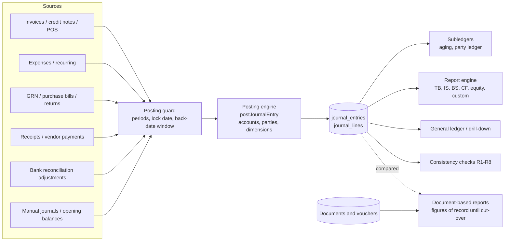
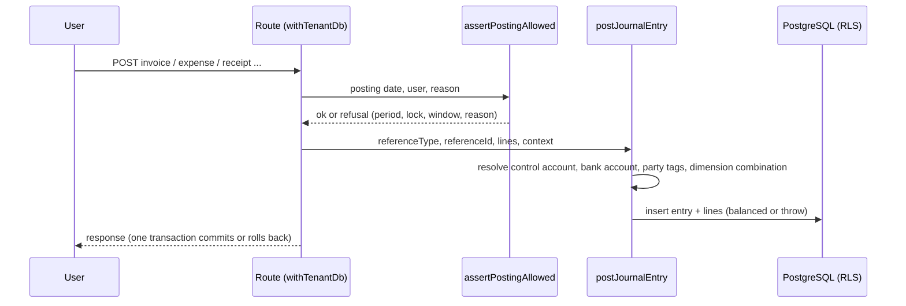
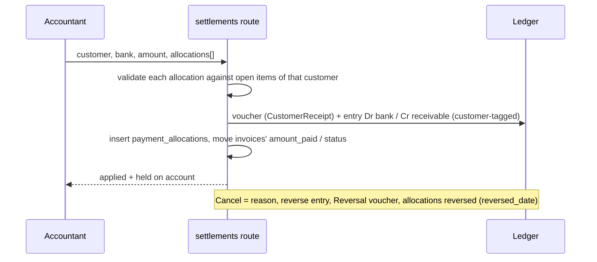
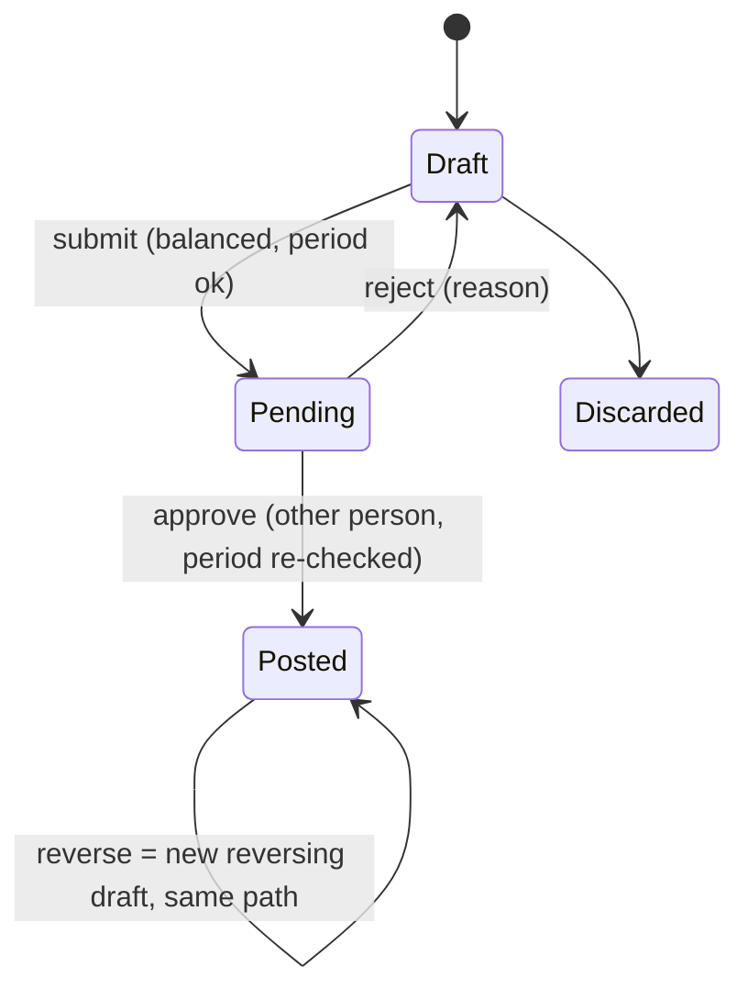

# Solution Design Document — General Ledger, Receivables, Payables 2.0

Version 1.0 / 2026-10-15. Realises the BRD (01) and SRS (02). The detailed mechanics (algorithms, tables, routes) are in the Technical Design (04); this document explains **how the solution is shaped and why**.

## 1. Design principles (apply to every future feature)

1. **One place money is recorded.** Every module is a *source*: it decides when and how much, then hands the posting engine a balanced set of lines. AR, AP, bank, trial balance, P&L, balance sheet are queries over the same rows (Blueprint core idea).
2. **A document names *who and what*, never accounts.** The engine resolves control account, bank account, expense-category account and dimension tags from a posting context. No route selects accounts by hand.
3. **Immutable ledger.** Posted lines are never edited; a correction is a mirrored reversal plus a new entry, carrying the original tags and parties.
4. **One guard, one engine, one query layer.** `assertPostingAllowed` for every dated posting; `postJournalEntry` for every write; `resolvedLines` for every read; `reportEngine` for every statement.
5. **Tenant isolation twice.** Application filter by `req.targetCompanyId` *and* PostgreSQL row-level security with composite `(company_id, id)` keys.
6. **Server-side figures.** Nothing a user acts on is computed in the browser or from the capped `/api/state`.
7. **Architecture first, no patches.** A defect is fixed where the rule is enforced (engine, guard, helper), never by adjusting one figure. New behaviour extends the one place that owns the concern.

## 2. Context

External systems: ZATCA (e-invoicing, outside this programme), SMTP (notifications), the browser print engine.

## 3. Logical architecture

| Layer | Responsibility | Main elements |
|---|---|---|
| Client (React) | Screens, forms, print preview | `src/components/LedgerModule.tsx` and `ledger/*` screens, `DocumentRenderer.tsx` |
| API (Express) | Authentication, tenant context, permission checks, route handlers | `server/routes/*`, `tenantDb.ts` (`withTenantDb`), `authz.ts` |
| Domain services | Posting, guard, settlements, subledger, reconciliation, reports | `ledger.ts`, `postingGuard.ts`, `postingContext.ts`, `settlements.ts`, `settlementFacts.ts`, `subledger.ts`, `bankReconciliation.ts`, `reportEngine.ts`, `financialReports.ts`, `postingPrint.ts` |
| Data | Tables, RLS, constraints | PostgreSQL; `src/db/schema.ts` single source of truth |
| Operations | Release, migration, back-fill, verification | `deploy/*`, `scripts/*` |

## 4. Key design decisions (summary; full log in annex H)

| # | Decision | Why |
|---|---|---|
| D1 | Company-owned chart with 16 posting **roles** that documents use; mapping is not retroactive | Documents stay simple; an accountant can re-point a role without rewriting history |
| D2 | Control accounts by `subledger_type`; customers/vendors can name their own | Several receivable accounts per company (trade, staff) without changing documents |
| D3 | Typed party tags (`customer_id`, `vendor_id`) on ledger lines, set by the engine | Aging and statements become queries; control account = sum of parties provable to the cent |
| D4 | Dimensions as a combination id per line (deduplicated), account rules, priority of defaults | One indexed filter; analytical, never a second ledger |
| D5 | One report-definition engine; five standard statements are definitions | No second calculation; designer comes free |
| D6 | `doc_date` vs `posting_date`; business dates are `date` | Reports and locks must agree on one meaning of "when" |
| D7 | Posting guard as one function with permission overrides and audit | Tier-1 practice: period status + authority + audit, not "days back" alone |
| D8 | A settlement is one voucher + one entry + N allocation rows; remainder on account | Matches how banks and customers behave; one cash movement, many documents |
| D9 | `settlementFacts` is the only translator between allocations and per-document payments for older reports | Two shapes of "paid" must never be reconciled in many places |
| D10 | Bank fee/interest is a voucher **and** an entry, restricted to expense/income accounts | Every cash movement is a voucher in this system; older statements must still balance |
| D11 | Reconciliation lock enforced in the reversal function | The only door through which a bank line can be undone |
| D12 | Documents print from one server-resolved posting payload | Print, screen and ledger cannot disagree |
| D13 | Ledger and document-based reports run side by side until a gated cut-over | De-risks go-live; "Ledger vs Documents" proves agreement |
| D14 | Maker-checker approval for manual journals first; amount-threshold rules (Sprint 11) layered on top: a matching rule replaces the single step, no rule leaves it unchanged | Control early, no big-bang migration of the journal flow |
| D15 | An approval request holds the **intent** (payload) of a document, never a half-posted document; the document is created by its own executor when the last level approves | Nothing can leak into the ledger, reports or payment runs while waiting; one engine serves every document type |
| D16 | A shortcut that would create and pay a document in one step is refused whole when a rule would hold either step | A rule cannot be bypassed by a convenience flow |
| D17 | One company setting decides whether the submitter may approve, for every document type | One place, owner/admin only, audited |
| D18 | Proposed: tax determination, computation, posting, reporting and settlement are separate steps; every document calls one tax engine and contains no tax logic | A rate on a document cannot also decide accounts, recovery and boxes; one engine gives one behaviour for invoice, POS, bill, expense, receipt and return |
| D19 | Proposed: the tax code is the unit; components with effective-dated rates; accounts hang off the code and component | History is never rewritten by a rate change; accounts are looked up, never typed |
| D20 | Proposed: profiles on the party, the item and the company; ordered determination rules, most specific first; no matching rule is an error, never zero; override only with the right and a reason | The data entry operator names the party and items; the system decides what to post and where |
| D21 | Proposed: recoverable and non-recoverable input tax are split at posting; apportionment is computed from the ledger | Cost and the tax asset are right from the first entry, and a mixed taxable and exempt business is supported |
| D22 | Proposed: the return, the registers and the settlement entry read ledger tax tags and reconcile to documents | One set of numbers; the consistency check proves it |
| D23 | Proposed: import of goods is automated only after foreign currency, landed cost and customs entry exist | The import entries need those three; building the tax side first would post wrong costs |
| D24 | Proposed: existing slabs migrate to tax codes in one idempotent script; afterwards the slab column is read-only | One source of tax treatment, no parallel logic |

## 5. Key flows

### 5.1 A document posts

### 5.2 Receipt across invoices

### 5.3 Bank reconciliation

```mermaid
stateDiagram-v2
  [*] --> InProgress: start (bank, date, ending balance)
  InProgress --> InProgress: tick / match lines, import statement, post fee or interest
  InProgress --> Completed: difference = 0 and no unmatched statement line
  Completed --> InProgress: reopen (permission + reason; latest session only; audited)
  InProgress --> [*]: discard (releases cleared lines)
```

### 5.4 Manual journal

## 6. Data design (overview)

* **Ledger:** `journal_entries` (reference, dates, reversal link), `journal_lines` (account or role, bank, dimension combination, customer/vendor tag, reconciliation link).
* **Chart:** `company_accounts` (+ `system_accounts` roles), dimensions (`dimension_*`, `cost_centers`, `account_dimension_rules`).
* **Documents and cash:** `invoices`, `expenses`, `purchase_bills`, `vouchers`, `payment_allocations`.
* **Control:** `posting_policies`, `fiscal_months`, `manual_journals`, `bank_reconciliations`, `bank_statement_lines`, `audit_logs`.
* **Reporting:** `report_definitions`, `report_rows`, `report_row_selectors`, `report_columns`.
Full column-level detail: annex A.

## 7. Security design

* Authentication by session; every request gets `req.targetCompanyId` (super-admin may select a company explicitly).
* `withTenantDb` opens one transaction on the restricted `erp_app_tenant` role and sets `app.company_id`; RLS policies on every table enforce it, composite keys stop cross-company references.
* Permissions: module registry (`permissionSchema.ts`), union of roles, server-enforced, record-state rules separate from permissions (annex C).
* Audit: elevated actions via `recordAuditLog`; posting overrides as `BACKDATED_POSTING`.
* No bulk-write endpoint exists.

## 8. Deployment and environments

Live (branch `master`, production) and Demo (branch `v2`, port 4000) are separate; releases run by script (`deploy/release-demo.sh`, `deploy/release.sh`): backup, pull and build, date migration, unique-key prerequisites, **reviewed** `db:push`, RLS predicates, check constraints, system accounts, back-fill, translations, reload and health check. See annex F.

## 9. Quality design

Real-HTTP + real-PostgreSQL tests (`tests/`), a 290-case catalogue (`docs/test-cases`), the consistency check as a runtime invariant, `npm run check:isolation` as a static tripwire. Strategy: document 05.

## 10. Risks and mitigations

| Risk | Mitigation |
|---|---|
| Two report families disagree | Ledger-vs-Documents + consistency rules; gated cut-over (S19) |
| A new posting path bypasses the guard | One guard function; route list in the posting-control doc; test PC-009 |
| Cross-tenant leak | RLS + composite keys + isolation tripwire + per-table tests |
| Schema push drops data | Reviewed plan, pre-push keys, date migration idempotent, backup first |
| Document drift | This set is generated from one traceable source and validated (`build-gl-docs.mjs --check`) |

## Taxation architecture (proposed, Sprints 14 to 14f; nothing built)

The full analysis, the tier-1 comparison, the scenarios (retail, imports, exports, manufacturing) and the open decisions are in the design note *Taxation and tax profiles* (chapter in the technical documentation). In one paragraph: a document names the party and the items; the tax engine looks up the **party tax profile**, the **item tax class**, the **company tax profile** and the **transaction type**, matches an ordered **determination rule** and returns a **tax code**; the code gives the components, the rates valid on the document date, the recoverability and the accounts; the posting engine writes the tax lines with their tags; the return, the registers and the settlement entry read those tags. The operator never chooses a tax or an account.

| Principle (decision) | Requirement ids | Sprint |
|---|---|---|
| One engine; codes, components, dated rates, accounts per code (D18, D19) | BR-TAX-04, BR-TAX-05, BR-TAX-17 | 14 |
| Slabs migrate to codes (D24) | BR-TAX-06 | 14 |
| Profiles, determination, override, supply natures, tax-inclusive pricing (D20) | BR-TAX-07..11, BR-TAX-03 | 14b |
| Recovery, return from the ledger, settlement entry (D21, D22) | BR-TAX-12, BR-TAX-13, BR-TAX-02 | 14c |
| Reverse charge and withholding | BR-TAX-14, BR-TAX-15 | 14d |
| Foreign currency, landed cost, customs entry, automatic import (D23) | BR-IMP-01..05 | 14e |
| Excise and other components | BR-TAX-16 | 14f |
